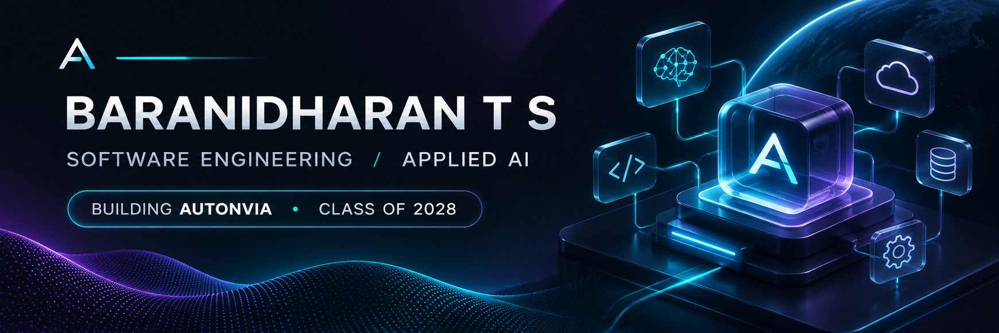
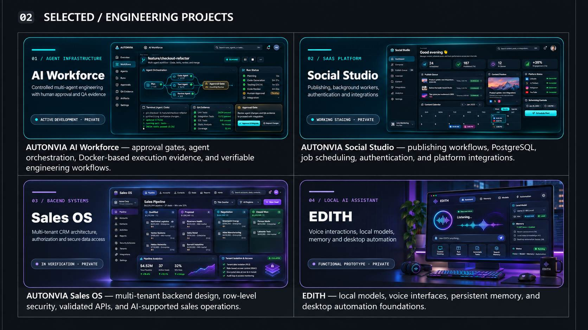

<!-- AUTONVIA ENGINEERING PROFILE — visual portfolio -->

  

  
  
  

  <strong>Engineering reliable SaaS, AI workflows, and systems that survive beyond a demo.</strong> 
  B.E. Computer Science &amp; Engineering · 2028 graduate · India

 

## 01 / The person behind the systems

<table>
<tr>
<td width="61%" valign="top">
  <h3>Hey, I'm Baranidharan 👋</h3>
  
I'm a Computer Science undergraduate and the founder of <a href="https://autonvia.com"><strong>AUTONVIA</strong></a>, where I'm developing full-stack SaaS platforms and applied AI systems.

  
I focus on the engineering beneath the interface: <strong>APIs, multi-tenant databases, access control, background workers, agent orchestration, automated tests, and failure recovery.</strong>

  
My aim is to become an exceptional <strong>software / applied AI engineer</strong> while continuing to build real products.

</td>
<td width="39%" valign="top">
  <h3>Currently exploring</h3>
  
🧠 <strong>Applied AI</strong> — tool calling, local inference, agent reliability

  
⚙️ <strong>Backend</strong> — APIs, PostgreSQL, isolation, queues

  
🧪 <strong>Quality</strong> — tests, evaluation, reproducibility

  
🎯 <strong>Career</strong> — 2027 internships / 2028 new-grad roles

</td>
</tr>
</table>

 

## 02 / Selected systems

  

  🎨 <strong>Concept visualizations, not actual product screenshots.</strong> Any interface data, analytics, integrations or test results pictured are fictional design examples.

<table>
<tr>
<td width="50%" valign="top">
  <h3>01 — AI Workforce</h3>
  
Supervised AI-agent workflows, approvals, controlled code execution, and engineering evidence.

  
 

</td>
<td width="50%" valign="top">
  <h3>02 — Social Studio</h3>
  
Multi-platform publishing, scheduling, OAuth integrations, PostgreSQL, and worker infrastructure.

  
 

</td>
</tr>
<tr>
<td width="50%" valign="top">
  <h3>03 — Sales OS</h3>
  
Multi-tenant CRM, authorization, row-level security, validated APIs, and AI-assisted sales operations.

  
 

</td>
<td width="50%" valign="top">
  <h3>04 — EDITH</h3>
  
Local AI assistant foundations, voice interfaces, persistent memory, and desktop automation.

  
 

</td>
</tr>
</table>

**Note on readiness:** These are ongoing private projects. Feature descriptions reflect implemented or tested foundations—not a claim that all four are production-ready.

 

## 03 / Public code you can actually inspect

<table>
<tr>
<td width="64%" valign="top">
  <h3><a href="https://github.com/barani-39/safedose-nearmiss">SafeDose NearMiss</a></h3>
  
A safety-oriented academic prototype for structured medication near-miss reporting and organizational review. Includes project documentation, automated-test descriptions, privacy boundaries, and a defined non-clinical scope.

  
<strong>Public repository · Academic prototype · Not for clinical use</strong>

  
<a href="https://github.com/barani-39/safedose-nearmiss">↗ Explore repository</a>

</td>
<td width="36%" valign="top">
  <h3><a href="https://github.com/barani-39/CodeGenome-AI">CodeGenome-AI</a></h3>
  
Early public exploration of code understanding and repository intelligence.

  
<strong>Public · Early-stage</strong>

  
<a href="https://github.com/barani-39/CodeGenome-AI">↗ View work in progress</a>

</td>
</tr>
</table>

 

## 04 / Engineering toolkit

  

| Foundation | Hands-on technologies |
|:---|:---|
| **Languages** | Java · Python · TypeScript · JavaScript · SQL |
| **Product engineering** | React · Next.js · FastAPI · Express · REST APIs |
| **Data &amp; security** | PostgreSQL · Firebase · Supabase · Authentication · RLS |
| **Applied AI** | LLM integrations · Tool-using agents · Local inference |
| **Infrastructure** | Docker · Cloudflare · Vercel · GitHub Actions · Automated tests |

 

## 05 / How I think about software

<table>
<tr>
<td width="33%" align="center" valign="top">
  <h3>🔐 Secure by design</h3>
  
Least privilege, tenant isolation, input validation, and safe execution boundaries.

</td>
<td width="33%" align="center" valign="top">
  <h3>🧪 Evidence first</h3>
  
Reproducible tests, honest readiness labels, and measurable outcomes.

</td>
<td width="33%" align="center" valign="top">
  <h3>🛠️ Built to evolve</h3>
  
Readable code, maintainable systems, observability, and recoverable failures.

</td>
</tr>
</table>

 

  <h3>Build with purpose. Verify the behavior. Keep improving.</h3>
  
Exploring opportunities in <strong>Software Engineering · Backend Systems · Applied AI</strong>

  
  
    
  Baranidharan T S · 2026 · AUTONVIA

