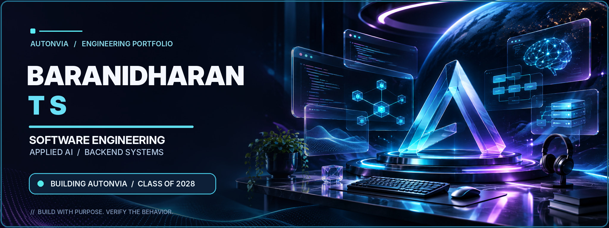
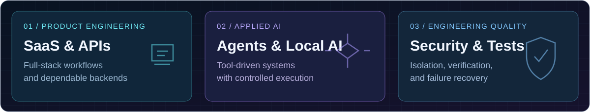

<!-- Premium engineering portfolio · 2026 -->

<p align="center">
  
</p>

<div align="center">

<a href="https://autonvia.com"></a>
<a href="https://github.com/barani-39/safedose-nearmiss"></a>
<a href="https://github.com/barani-39?tab=repositories"></a>

**Software Engineering × Applied AI × Product Building**

<sub>B.E. Computer Science & Engineering · India · Graduating in 2028</sub>

</div>

---

## `01` &nbsp; HELLO, WORLD

<table>
<tr>
<td width="61%" valign="top">

### I build the systems behind the interface.

I'm **Baranidharan T S**, a Computer Science engineering undergraduate and founder of [**AUTONVIA**](https://autonvia.com).

I work on full-stack SaaS products, multi-tenant backends, AI-agent workflows, automation, and developer tooling. I'm especially interested in **software reliability, security, and the engineering decisions that turn demos into dependable products**.

</td>
<td width="39%" valign="top">

**`currently_building.md`**

```text
> AUTONVIA products
> Supervised AI agents
> Local AI assistant
> SaaS infrastructure

focus = "Build. Test. Improve."
grad  = 2028
```

</td>
</tr>
</table>

### The engineering areas I care about

<p align="center">
  
</p>

---

## `02` &nbsp; SELECTED ENGINEERING PROJECTS

<p align="center">
  <a href="./assets/selected-engineering-projects-showcase.jpg">
    
  </a>
</p>

<p align="center"><sub>✨ <strong>AI-generated concept artwork</strong> · These are illustrative interfaces, not verified product screenshots. Any numbers, statuses or UI data depicted inside the artwork are fictional.</sub></p>

<table>
<tr>
<td width="50%" valign="top">
  <h3>01 / AI Workforce</h3>
  Supervised agents, approval gates, controlled code execution and QA evidence.<br/><br/>
  <code>ACTIVE DEVELOPMENT</code> · <code>PRIVATE SOURCE</code>
</td>
<td width="50%" valign="top">
  <h3>02 / Social Studio</h3>
  Social publishing, authentication, integrations, scheduled workers and PostgreSQL.<br/><br/>
  <code>WORKING STAGING</code> · <code>PRIVATE SOURCE</code>
</td>
</tr>
<tr>
<td width="50%" valign="top">
  <h3>03 / Sales OS</h3>
  Multi-tenant CRM, row-level security, API validation and AI-assisted sales workflows.<br/><br/>
  <code>IN VERIFICATION</code> · <code>PRIVATE SOURCE</code>
</td>
<td width="50%" valign="top">
  <h3>04 / EDITH</h3>
  Local AI, voice interfaces, persistent memory and desktop automation foundations.<br/><br/>
  <code>FUNCTIONAL PROTOTYPE</code> · <code>PRIVATE SOURCE</code>
</td>
</tr>
</table>

<sub>These four commercial/personal projects are still evolving. Descriptions reflect implemented or tested foundations—not a claim that every product is production-ready.</sub>

---

## `03` &nbsp; PUBLIC CODE & REAL ENGINEERING EVIDENCE

<table>
<tr>
<td width="65%" valign="top">
<h3><a href="https://github.com/barani-39/safedose-nearmiss">🔬 SafeDose NearMiss</a></h3>

A privacy-aware academic prototype for structured medication near-miss reporting and operational review, with technical documentation, a defined non-clinical scope, and documented automated tests.

**Public code · Academic prototype · Not for clinical use**

<a href="https://github.com/barani-39/safedose-nearmiss"><strong>Explore repository →</strong></a>
</td>
<td width="35%" valign="top">
<h3><a href="https://github.com/barani-39/CodeGenome-AI">🧩 CodeGenome-AI</a></h3>

Early public work exploring repository intelligence and code understanding.

**Public code · Early stage**

<a href="https://github.com/barani-39/CodeGenome-AI"><strong>View work in progress →</strong></a>
</td>
</tr>
</table>

> **Evidence over aesthetics.** I distinguish what is implemented, what is tested, and what is still an experiment. Public source code is available through the repository links above; private AUTONVIA code is not publicly accessible.

---

## `04` &nbsp; TECH STACK

<p align="center">
  
</p>

| Focus | Technologies and concepts |
| :-- | :-- |
| **Languages** | Java · Python · TypeScript · JavaScript · SQL |
| **Full-stack** | React · Next.js · FastAPI · Express · REST APIs |
| **Data & security** | PostgreSQL · Supabase · Firebase · Authentication · RLS |
| **Applied AI** | LLM integration · Tool-using agents · Local inference · Workflow orchestration |
| **Engineering** | Docker · GitHub Actions · Cloudflare · Vercel · Automated testing |

---

## `05` &nbsp; ENGINEERING PRINCIPLES

| 🔐 Secure by design | 🧪 Verify the behavior | ⚙️ Design for failure |
| :-- | :-- | :-- |
| Tenant isolation, least privilege and credential safety | Tests, evidence, review and realistic readiness labels | Timeouts, retries, recovery paths and observable errors |

---

<div align="center">

### Build with purpose. Verify the behavior.

Interested in **Software Engineering, Backend Systems, and Applied AI** opportunities.

<a href="https://autonvia.com"></a>
<a href="https://github.com/barani-39?tab=repositories"></a>

<sub>© Baranidharan T S · Engineering & Applied AI · 2028</sub>

</div>
