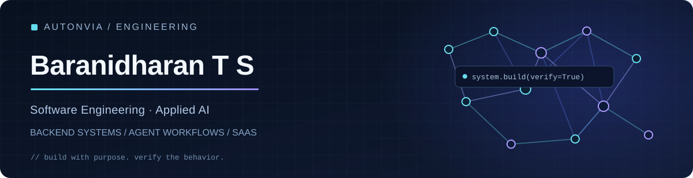
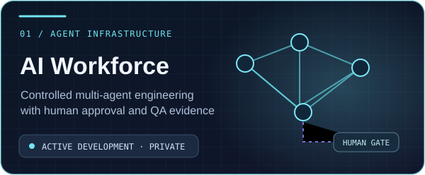
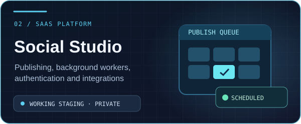
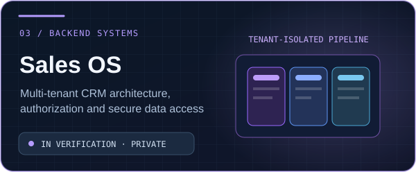
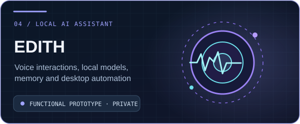

<div align="center">



<br/>

<a href="https://autonvia.com"></a>
<a href="https://github.com/barani-39?tab=repositories"></a>
<a href="https://github.com/barani-39/safedose-nearmiss"></a>

<br/><br/>

**B.E. Computer Science & Engineering · Class of 2028 · India**

Building thoughtful software at the intersection of **backend engineering**, **applied AI**, and **SaaS**.

<sub>Systems over buzzwords · Evidence over claims · Engineering over decoration</sub>

</div>

---

### `01` &nbsp; ABOUT / WHAT I'M BUILDING

<table>
<tr>
<td width="57%" valign="top">

**Hey, I'm Baranidharan.** I study Computer Science and build software products through **[AUTONVIA](https://autonvia.com)**.

My work involves multi-tenant applications, AI-agent systems, background jobs, authentication, API integration, local inference, and software verification.

I care about **reliability, security, and explainable engineering decisions**—including knowing when a product is still a prototype.

</td>
<td width="43%" valign="top">

```yaml
profile:
  focus: [Software Engineering, Applied AI]
  building: AUTONVIA
  languages: [Java, Python, TypeScript]
  interests:
    - Backend and distributed systems
    - AI agents and developer tools
    - Reliable SaaS infrastructure
  graduation: 2028
```

</td>
</tr>
</table>

### `02` &nbsp; SELECTED / ENGINEERING PROJECTS

<div align="center">
<table>
<tr>
<td width="50%" valign="top">

<br/>
<b>AUTONVIA AI Workforce</b> — approval gates, agent orchestration, Docker-based execution evidence, and verifiable engineering workflows.
</td>
<td width="50%" valign="top">

<br/>
<b>AUTONVIA Social Studio</b> — publishing workflows, PostgreSQL, job scheduling, authentication, and platform integrations.
</td>
</tr>
<tr>
<td width="50%" valign="top">

<br/>
<b>AUTONVIA Sales OS</b> — multi-tenant backend design, row-level security, validated APIs, and AI-supported sales operations.
</td>
<td width="50%" valign="top">

<br/>
<b>EDITH</b> — local models, voice interfaces, persistent memory, and desktop automation foundations.
</td>
</tr>
</table>
</div>

> **Engineering status:** The four product repositories above are private. Features described here are implemented or tested foundations, **not** claims of complete production readiness. Public case studies and reproducible demonstrations are being prepared.

### `03` &nbsp; PUBLIC / CODE YOU CAN INSPECT

<a href="https://github.com/barani-39/safedose-nearmiss"></a>

**[SafeDose NearMiss](https://github.com/barani-39/safedose-nearmiss)** — a privacy-aware academic reporting prototype with role-based workflows, audit records, automated testing documentation, and explicit safety boundaries. **Not for clinical use.** Its documented test claims are provided in the repository; they are not independently certified.

**[CodeGenome-AI](https://github.com/barani-39/CodeGenome-AI)** — an early-stage public repository exploring software intelligence and code understanding. Work in progress.

### `04` &nbsp; TOOLKIT / TECHNOLOGIES

<div align="center">


</div>

| Area | Working with |
| :-- | :-- |
| **Software development** | Java · Python · TypeScript · JavaScript · SQL |
| **Frontend and backend** | React · Next.js · FastAPI · Express · REST APIs |
| **Data and security** | PostgreSQL · Firebase · Supabase · RLS · Authentication |
| **AI engineering** | LLM integration · Agent workflows · Local inference · Tool calling |
| **Delivery and quality** | Git · GitHub · Docker · Vercel · Cloudflare · Automated testing |

### `05` &nbsp; ENGINEERING / PRINCIPLES

<table>
<tr>
<td width="50%"><b>01. Verify what ships</b><br/>Tests, reproducible behavior, and honest readiness labels.</td>
<td width="50%"><b>02. Design for failure</b><br/>Timeouts, retries, safe approvals, and observability.</td>
</tr>
<tr>
<td width="50%"><b>03. Keep boundaries strong</b><br/>Least privilege, tenant isolation, and credential hygiene.</td>
<td width="50%"><b>04. Build for real users</b><br/>Useful workflows, maintainable architecture, and thoughtful UX.</td>
</tr>
</table>

### `06` &nbsp; NEXT / ENGINEERING MILESTONES

- Deepening **Java DSA**, DBMS, OS, networking, and system design fundamentals.
- Producing **sanitized architecture case studies** and live demonstrations of selected private projects.
- Preparing for **2027 internships** and **2028 graduate software engineering / applied AI roles**.

---

<div align="center">

### Building systems that work beyond the demo.

<a href="https://autonvia.com"></a>
<a href="https://github.com/barani-39?tab=repositories"></a>

<sub>© Baranidharan T S · Built with intention, improved with evidence.</sub>

</div>
